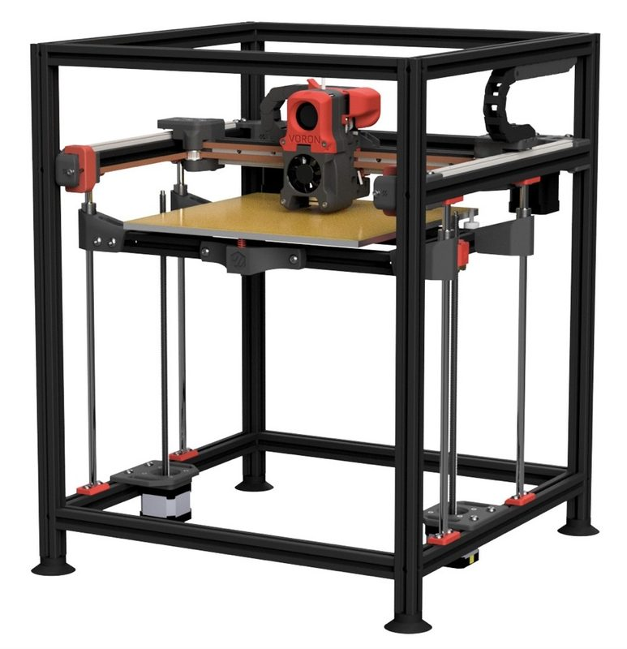
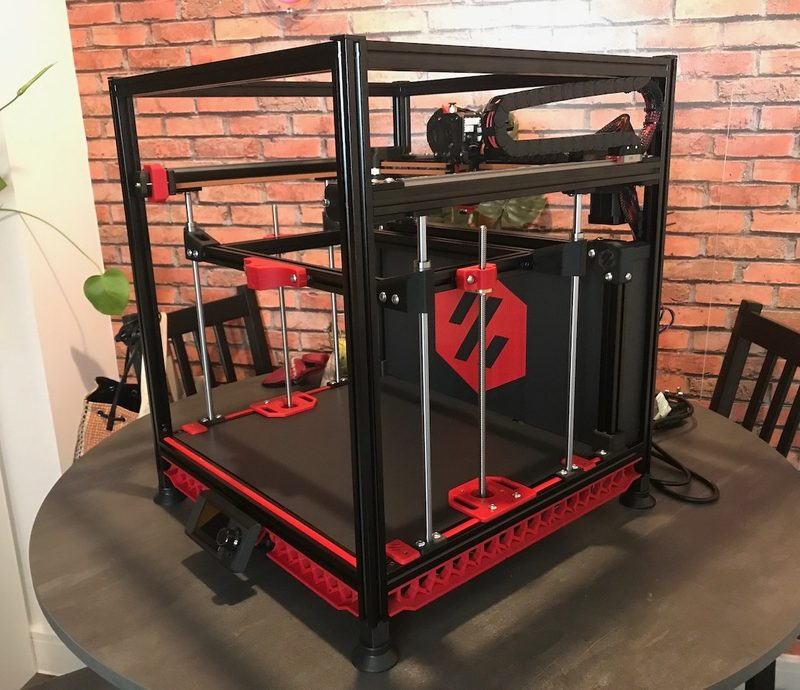
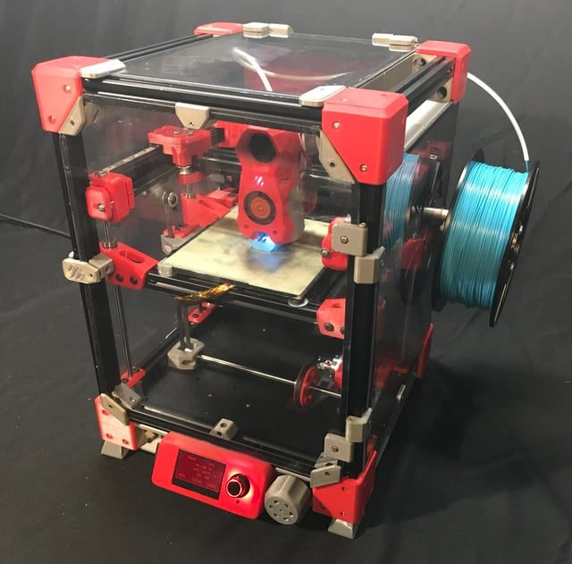
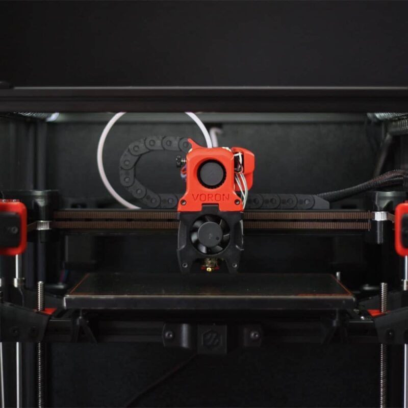

# Voron Trident (V1 line)

[Catalog row](../../README.md#voron-trident) · [Gallery](../../GALLERY.md)

| Field | Value |
| --- | --- |
| Section | CoreXY · Medium (181–299 mm representative X/Y size) |
| Project page | [https://github.com/VoronDesign/Voron-Trident](https://github.com/VoronDesign/Voron-Trident) |
| Author | Voron family |
| About | Fixed gantry and independently driven Z bed; current R2 release revises XY and Z motion. It replaced the Voron 1.8, the last of the V1 line, which already had the fixed gantry and the stacked belts. The Voron 1.0 is in the [Voron Legacy](../../README.md#voron-legacy) row. |
| Build volume (X×Y×Z) | 250: 250×250×250 300: 300×300×250 350: 350×350×250 |
| Exterior (W×D×H) | 250: 410×410×500 300: 460×460×500 350: 510×510×500 |
| Latest version | R2 [2026-06](https://github.com/VoronDesign/Voron-Trident/releases/tag/VTr2) |
| Stars Likes Views |  |
| Links | [CAD](https://github.com/VoronDesign/Voron-Trident/tree/HEAD/CAD) [Manual](https://github.com/VoronDesign/Voron-Trident/blob/HEAD/Manual/Assembly_Manual_Trident.pdf) [CAD](https://github.com/VoronDesign/Voron-1/tree/Voron1.8/CAD) old V1.8 [Manual](https://github.com/VoronDesign/Voron-1/tree/Voron1.8/Docs) old V1.8 [CAD](https://github.com/VoronDesign/Voron-1/tree/Voron1.6/CAD) old V1.6 |
| Groups | [Discord](https://discord.gg/voron) EN 40.8K [Reddit](https://www.reddit.com/r/VORONDesign/) EN 39.7K [Forum](https://forum.vorondesign.com/) EN 12.8K [Facebook](https://www.facebook.com/groups/voron.trident/) EN 1.4K [Facebook](https://www.facebook.com/groups/voroncorexy/) EN 54.2K [Facebook](https://www.facebook.com/groups/479932403103163/) DE 2.6K [Telegram](https://t.me/aboutvoron) RU 551 [Telegram](https://t.me/voron_siboor_es) ES 212 [Forum](https://www.lesimprimantes3d.fr/forum/154-voron/) FR |
| License | [GPL-3.0](https://github.com/VoronDesign/Voron-Trident/blob/main/LICENSE) |

## Pictures (14)

<table>
<tr><td align="center" width="33%"> Photo: <a href="https://github.com/VoronDesign">Voron Design</a></td><td align="center" width="33%"> Photo: <a href="https://www.formbot3d.com">Formbot</a></td><td align="center" width="33%"> Photo: <a href="https://www.3dprintersonlinestore.com">3dprintersonlinestore</a></td></tr>
<tr><td align="center" width="33%"> Photo: <a href="https://github.com/VoronDesign">Voron Design</a></td><td align="center" width="33%"> Photo: <a href="https://github.com/VoronDesign">Voron Design</a></td><td align="center" width="33%"> Photo: <a href="https://www.reddit.com/user/toastteebun">u/toastteebun</a></td></tr>
<tr><td align="center" width="33%"> Photo: <a href="https://www.printables.com/@HandsomePotato">HandsomePotato</a></td><td align="center" width="33%"> Photo: <a href="https://www.jonashietala.se">Jonas Hietala</a></td><td align="center" width="33%"> Version: V1.8 Photo: <a href="https://vorondesign.com">Voron Design</a></td></tr>
<tr><td align="center" width="33%"> Version: V1.8 Photo: <a href="https://www.mikethomas.info">Mike Thomas</a></td><td align="center" width="33%"> Version: V1.8 Photo: <a href="https://www.reddit.com/user/Armatus-Designs">u/Armatus-Designs</a></td><td align="center" width="33%"> Version: V1.8 Photo: <a href="https://vorondesign.com">Voron Design</a></td></tr>
<tr><td align="center" width="33%"> Version: V1.8 Photo: <a href="https://uniqueprints.shop/">uniqueprints</a></td><td align="center" width="33%"> Version: V1.8 Photo: <a href="https://caribou3d.com/">caribou3d/LDO</a></td></tr>
</table>

## Other homes of the files

- [voron.zip](https://voron.zip/done/VT.zip): official release archive of the Trident files, linked from vorondesign.com. License not stated.
- [voron.zip](https://voron.zip/web/viewer.html?file=manuals/Assembly_Manual_Trident.pdf): copy of the assembly manual PDF. License not stated.
- Wayback Machine: [latest snapshot](https://web.archive.org/web/20260923154213/https://github.com/VoronDesign/Voron-Trident), 2026-09-23.

## Mods and variants

- [Voron Trident 5-axis](https://github.com/Buzzloopster/Voron-Trident-5-axis) by Buzzloopster: an A tilt and endless C rotation bed under the stock CoreXY, run by RepRapFirmware robot kinematics, base Voron Trident 250. GPL-3.0.

## Popular mods

- [BentoBox v2.0](https://www.printables.com/model/272525-bentobox-v20-carbon-filter-for-bambu-lab-x1c-enclo) by thrutheframe: carbon air scrubber that recirculates chamber air. CC BY-NC-SA 4.0.
- [VoronUsers](https://github.com/VoronDesign/VoronUsers) by Voron community: official collection of community mods, sorted by printer and author. GPL-3.0.
- [ERCF v2 (Enraged Rabbit Carrot Feeder)](https://github.com/Carrot-collective/ERCF_v2) by Carrot Collective (original ERCF by Ette): multi-material unit that selects one of many filaments and feeds it to a single direct-drive toolhead. GPL-3.0.
- [Klicky Probe](https://github.com/jlas1/Klicky-Probe) by jlas1: magnetic microswitch Z probe that the toolhead picks up from a dock before probing and returns after. GPL-3.0.
- [Dragon Burner and Rapid Burner toolheads](https://github.com/chirpy2605/voron/tree/main/V0/Dragon_Burner) by chirpy2605: compact toolheads with twin 4010 part-cooling blowers, built for the V0.2 and mounted on the larger Vorons with adapter plates. GPL-3.0.
- [StealthChanger](https://github.com/DraftShift/StealthChanger) by DraftShift Design: tool changer with a bushing-and-pin shuttle that docks several Stealthburner, Dragon Burner, Xol, A4T and other toolheads. GPL-3.0.
- [Xol Toolhead](https://github.com/Armchair-Heavy-Industries/Xol-Toolhead) by Armchair Heavy Industries: modular toolhead and X carriage, the successor of Mantis Xol 2, with swappable hotend, extruder and toolboard mounts. CC BY-NC-SA 4.0.
- [Clicky-Clack Fridge Door](https://github.com/tanaes/whopping_Voron_mods/tree/main/clickyclacky_door) by tanaes: single framed front door on lift-off hinges with a latch that pulls it shut against foam tape to seal the chamber. GPL-3.0.
- [Galileo 2](https://github.com/JaredC01/Galileo2) by JaredC01: 9:1 planetary drop-in extruder for the Stealthburner (G2E), plus planetary Z drives (G2Z) for V2-style printers. GPL-3.0.
- [Voron Tap](https://github.com/VoronDesign/Voron-Tap) by Voron Design: nozzle Z probe: the whole toolhead slides on a rail carriage and trips an optical switch when the nozzle touches the bed. GPL-3.0.
- [A4T Toolhead](https://github.com/Armchair-Heavy-Industries/A4T) by Armchair Heavy Industries: toolhead built around a 4010 blower for front-rail Vorons, on the Xol, stock CW2 or Tap carriage. CC BY-NC-SA 4.0.
- [Filametrix](https://www.printables.com/model/638605-filametrix-mmuercf-filament-cutter-voron) by sorted: lever filament cutter built into the Stealthburner extruder body, used for faster MMU and ERCF swaps. GPL-3.0.
- [Monolith Gantry](https://github.com/Monolith3D/Monolith_Gantry) by Monolith3D: configurable XY gantry with a shorter belt path and optional AWD that keeps the CoreXY layout. CC BY-NC-SA 4.0.
