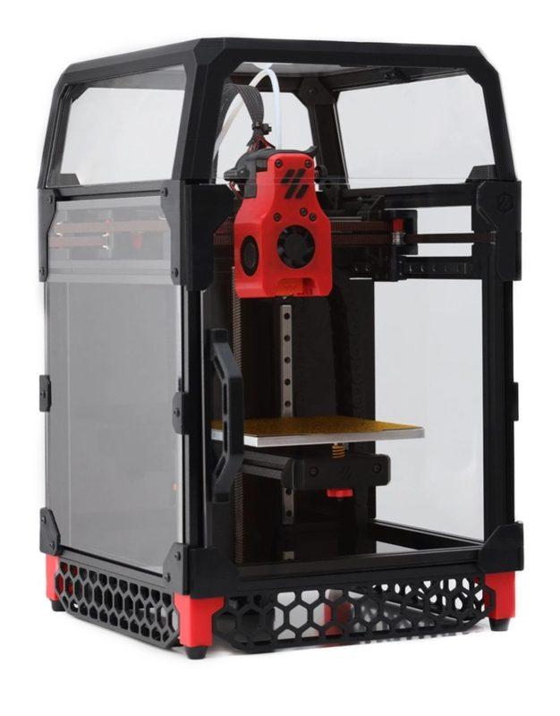
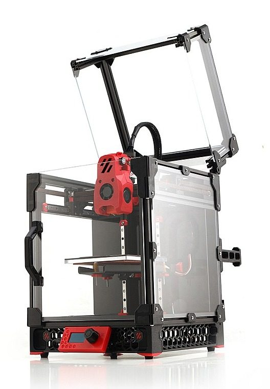
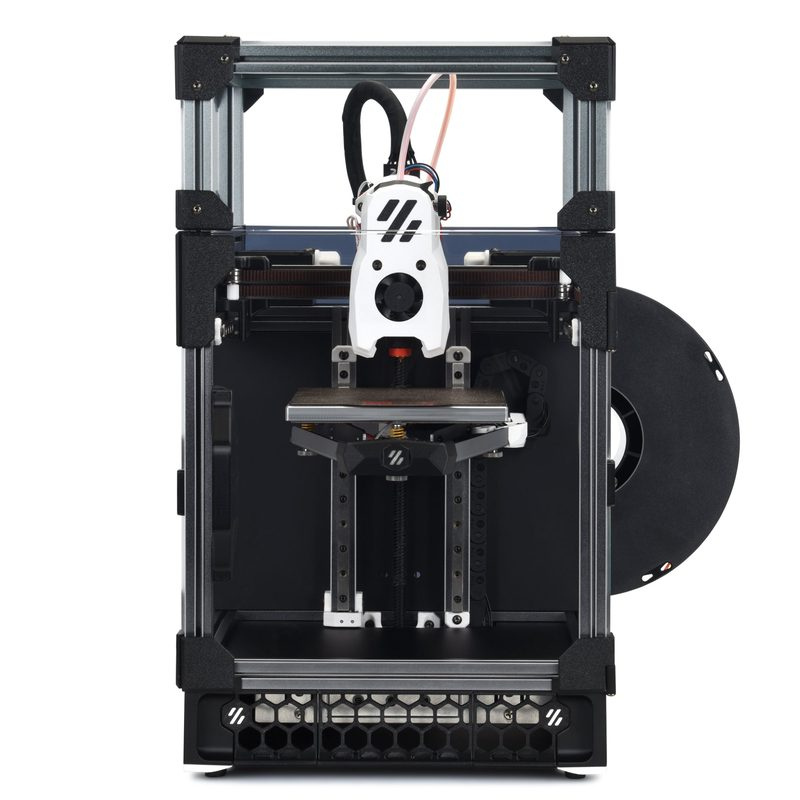
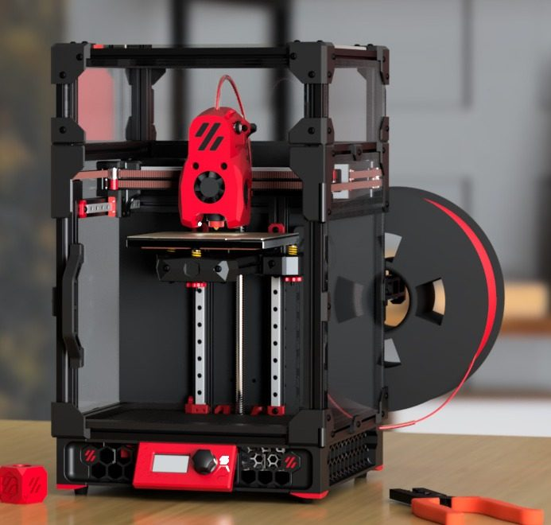
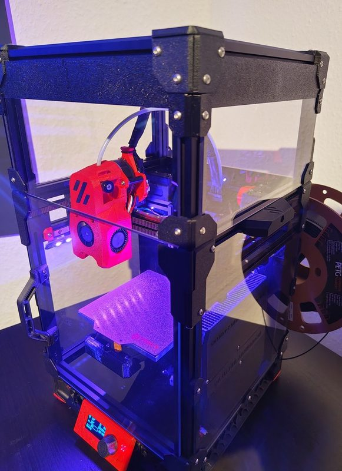
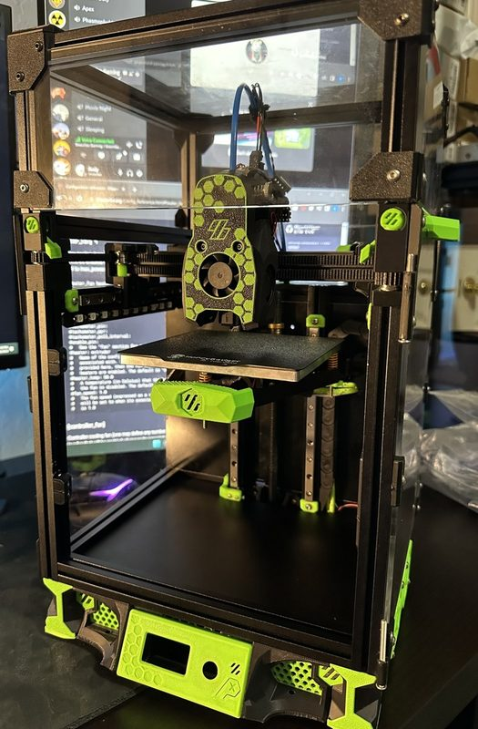
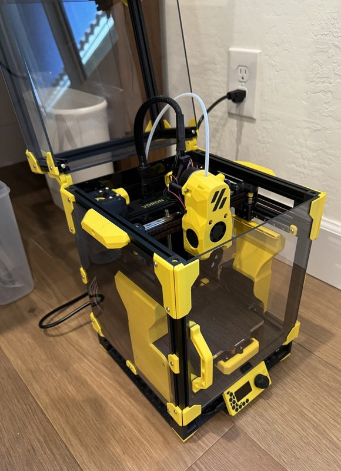
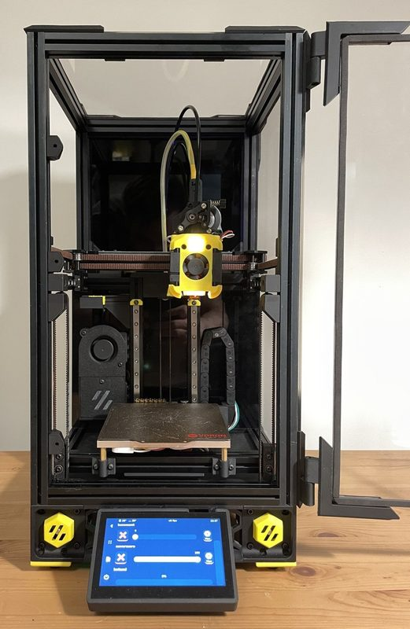
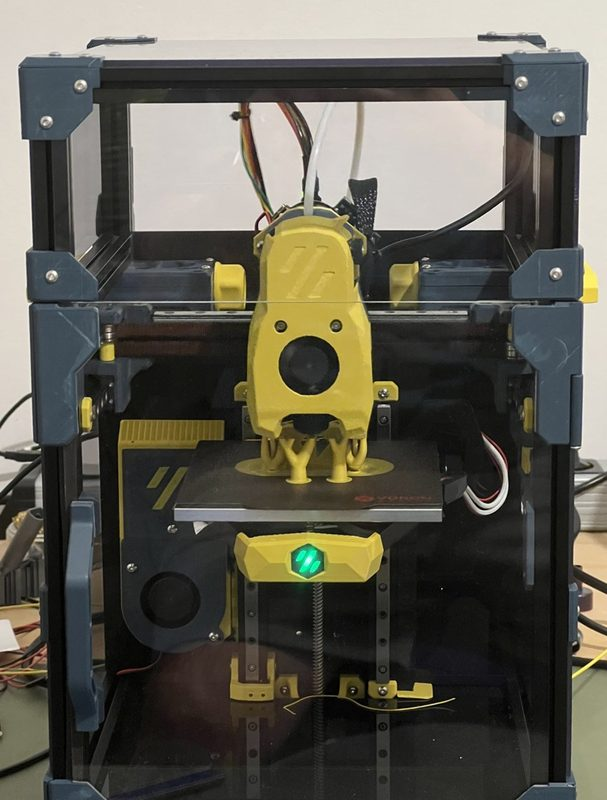
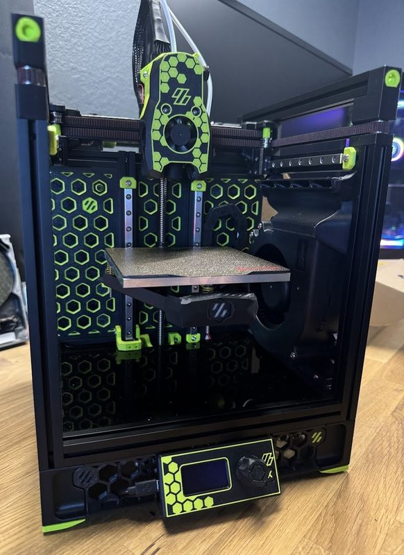

# Voron V0

[Catalog row](../../README.md#voron-v0) · [Gallery](../../GALLERY.md)

| Field | Value |
| --- | --- |
| Section | CoreXY · Small (≤180 mm representative X/Y size) |
| Project page | [https://github.com/VoronDesign/Voron-0](https://github.com/VoronDesign/Voron-0) |
| Author | Voron family |
| About | Compact enclosed CoreXY platform. |
| Build volume (X×Y×Z) | 120×120×120 |
| Exterior (W×D×H) | 230×230×280 |
| Latest version | V0.2r1 [2023-06](https://github.com/VoronDesign/Voron-0/commit/77acde9b0de405490823519b78f6056098420dee) |
| Stars Likes Views |  |
| Links | [CAD](https://github.com/VoronDesign/Voron-0/tree/HEAD/CAD) [Manual](https://github.com/VoronDesign/Voron-0/blob/HEAD/Manuals/VORON_V0.2r1_Assembly_Manual.pdf) |
| Groups | [Discord](https://discord.gg/voron) EN 40.8K [Reddit](https://www.reddit.com/r/VORONDesign/) EN 39.7K [Forum](https://forum.vorondesign.com/) EN 12.8K [Facebook](https://www.facebook.com/groups/voroncorexy/) EN 54.2K [Facebook](https://www.facebook.com/groups/479932403103163/) DE 2.6K [Telegram](https://t.me/aboutvoron) RU 551 [Telegram](https://t.me/voron_siboor_es) ES 212 [Forum](https://www.lesimprimantes3d.fr/forum/154-voron/) FR |
| License | [GPL-3.0](https://github.com/VoronDesign/Voron-0/blob/Voron0.2r1/LICENSE) |

## Pictures (11)

<table>
<tr><td align="center" width="33%"> Photo: <a href="https://www.3dprintersonlinestore.com">3dprintersonlinestore</a></td><td align="center" width="33%"> Photo: <a href="https://www.formbot3d.com">Formbot</a></td><td align="center" width="33%"> Photo: <a href="https://www.3dprintersonlinestore.com">3dprintersonlinestore</a></td></tr>
<tr><td align="center" width="33%"> Photo: <a href="https://phaserfpv.com.au">phaserfpv</a></td><td align="center" width="33%"> Photo: <a href="https://github.com/VoronDesign">Voron Design</a></td><td align="center" width="33%"> Photo: <a href="https://www.printables.com/@Screase">Screase</a></td></tr>
<tr><td align="center" width="33%"> Photo: <a href="https://www.printables.com/@Andrew_638442">Andrew</a></td><td align="center" width="33%"> Photo: <a href="https://www.printables.com/@chrisheninger">chrisheninger</a></td><td align="center" width="33%"> Photo: <a href="https://www.printables.com/@otann">Otann</a></td></tr>
<tr><td align="center" width="33%"> Photo: <a href="https://www.printables.com/@UloPe">UloPe</a></td><td align="center" width="33%"> Photo: <a href="https://www.printables.com/@thediymaker">Johnathan Lee</a></td></tr>
</table>

## Other homes of the files

- [voron.zip](https://voron.zip/done/v0.zip): official release archive of the V0.2 files, linked from vorondesign.com. License not stated.
- [voron.zip](https://voron.zip/web/viewer.html?file=manuals/VORON_V0.2r1_Assembly_Manual.pdf): copy of the V0.2r1 assembly manual PDF. License not stated.
- Wayback Machine: [latest snapshot](https://web.archive.org/web/20260602103430/https://github.com/VoronDesign/Voron-0), 2026-06-02.

## Mods and variants

- [Tri-Zero](https://github.com/zruncho3d/tri-zero) by zruncho3d: triple belted Z and automatic bed leveling, 120 mm or Plus50 170 mm; also supports a fresh build. GPL-3.0.
- [Pandora's Box](https://github.com/MasturMynd/Pandoras_Box) by MasturMynd: larger X and Y travel, triple belted Z, and automatic bed tramming. GPL-3.0.
- [Hex-Zero (HX0)](https://github.com/Alexander-T-Moss/Hex-Zero) by Alexander-T-Moss: Tri-Zero Z motion redesign with a revised Pandora gantry and a stiffer flying bed. GPL-3.0.

## Popular mods

- [VoronUsers](https://github.com/VoronDesign/VoronUsers) by Voron community: official collection of community mods, sorted by printer and author. GPL-3.0.
- [Nevermore Micro](https://github.com/nevermore3d/Nevermore_Micro) by nevermore3d: small activated-carbon recirculating filter that sits inside the chamber. GPL-3.0.
- [Klicky Probe](https://github.com/jlas1/Klicky-Probe) by jlas1: magnetic microswitch Z probe that the toolhead picks up from a dock before probing and returns after. GPL-3.0.
- [Dragon Burner and Rapid Burner toolheads](https://github.com/chirpy2605/voron/tree/main/V0/Dragon_Burner) by chirpy2605: compact toolheads with twin 4010 part-cooling blowers, built for the V0.2 and mounted on the larger Vorons with adapter plates. GPL-3.0.
- [Bento mini](https://www.printables.com/model/517219-bento-mini-for-bambu-lab-x1c-p1p-and-voron-v02) by thrutheframe: compact carbon recirculating filter. CC BY-NC 4.0.
- [V0 Auxiliary Fan](https://github.com/JackJack3231/V0-Auxiliary-Fan) by JackJack3231: side-mounted blower and duct that adds chamber-wide part cooling for PLA and bridges. GPL-3.0.
- [Mini-AfterSherpa](https://github.com/PrintersForAnts/Mini-AfterSherpa) by PrintersForAnts: modular toolhead with a Sherpa Mini extruder for the Mini Afterburner-style X carriage. GPL-3.0.
- [Kirigami Bed](https://github.com/christophmuellerorg/voron_0_kirigami_bed) by christophmuellerorg: laser-cut and bent one-piece sheet metal bed carrier that is light and stiff and leaves the mount screws reachable. CC BY-SA 4.0 and GPL-3.0 (sheet metal part).
- [Tulip](https://github.com/Amekyras/tulip) by Amekyras: pin mod for the AB motor mounts, XY joints and front idlers, with front idler tensioners. AGPL-3.0.
- [BoxZero](https://github.com/zruncho3d/BoxZero) by zruncho3d: replaces the tophat with a taller full-box frame that is stiffer and seals better. GPL-3.0.
- [Mini Stealthburner](https://github.com/atrushing/Mini_Stealth) by atrushing: scaled-down Stealthburner toolhead with many hotend and extruder options. GPL-3.0.
