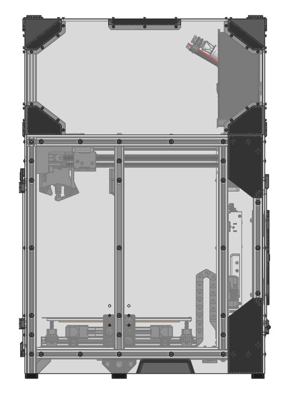
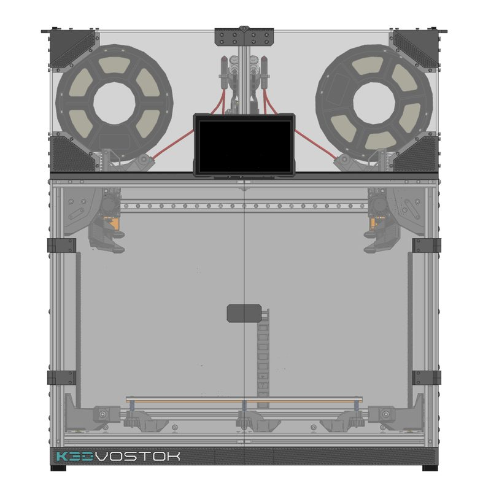
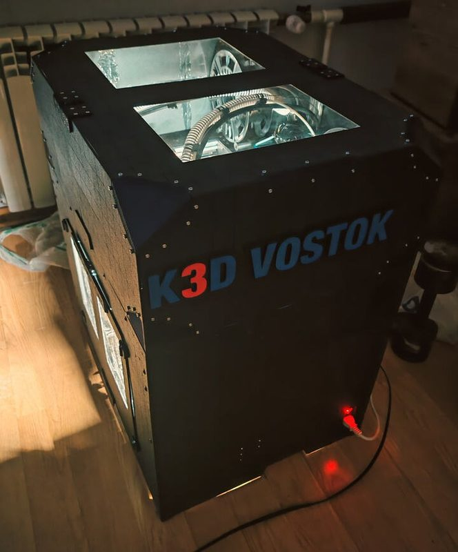
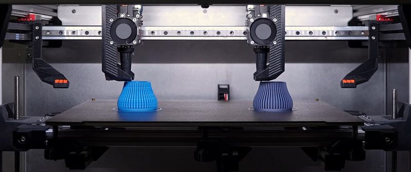
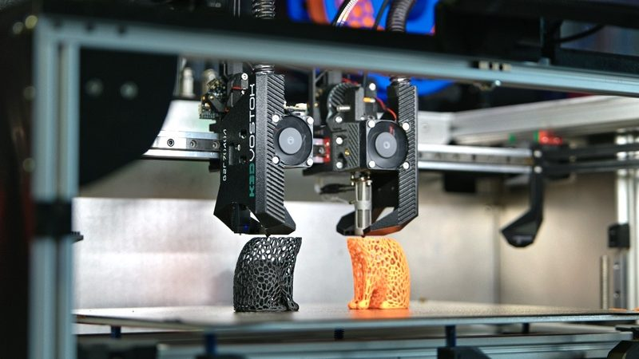
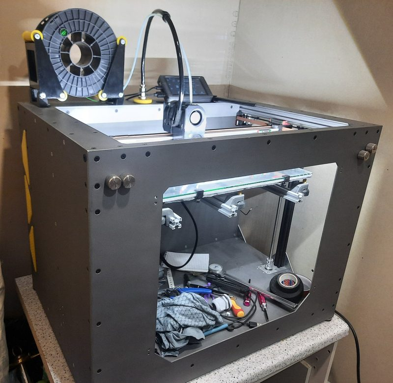
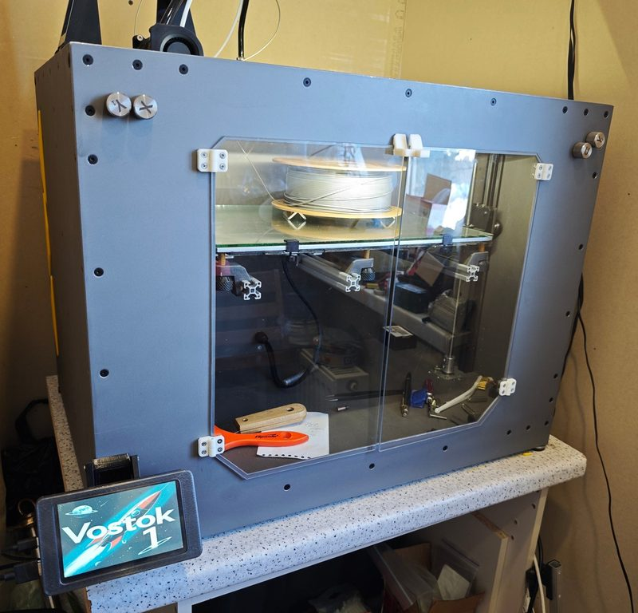

# K3D VOSTOK v9.5

[Catalog row](../../README.md#vostok) · [Gallery](../../GALLERY.md)

| Field | Value |
| --- | --- |
| Section | CoreXY · Large (≥300 × 300 mm) |
| Project page | [https://k3d.tech/vostok/](https://k3d.tech/vostok/) |
| Author | Dmitry Sorkin / K3D |
| About | Large, open-design Markforged-derived XY/2 IDEX with dual printheads. Russian-language HTML documentation; use your browser’s page translation to read it in English. |
| Build volume (X×Y×Z) | M: 400×250×250 L: 400×400×400 XL: 500×500×500 |
| Exterior (W×D×H) | — |
| Latest version | v9.5 [2026-09](https://github.com/dmitry-sorkin/k3d-site/commit/216940b018256db9034c302572943339170f926e) |
| Stars Likes Views | [⏯️⁠107K](https://www.youtube.com/watch?v=upwTgwNi1PQ) [❤️⁠3.9K](https://www.youtube.com/watch?v=upwTgwNi1PQ) |
| Links | [STEP](https://k3d.tech/vostok/releases/9.5/assets/vostok_v9.5_assembly.stp.7z) [BOM](https://k3d.tech/vostok/releases/9.5/assets/vostok_v9.5_bom.xlsx) [Manual](https://k3d.tech/vostok/manual/prepare/start/) [Config](https://github.com/dmitry-sorkin/vostok_configuration/blob/main/README.en.md) |
| Groups | [Telegram](https://t.me/vostok3dp) RU 4.2K [Telegram](https://t.me/k3d_vostok) RU 3.4K [Telegram](https://t.me/K_3_D) RU 36.2K |
| License | [CC BY 4.0](https://k3d.tech/vostok/) |

## Pictures (8)

<table>
<tr><td align="center" width="33%"> Photo: <a href="https://www.youtube.com/@SorkinDmitry">Dmitry Sorkin (K3D)</a></td><td align="center" width="33%"> Photo: <a href="https://www.youtube.com/@SorkinDmitry">Dmitry Sorkin (K3D)</a></td><td align="center" width="33%"> Photo: <a href="https://forum.k3d.tech/u/dsorkin">Dmitry Sorkin (K3D)</a></td></tr>
<tr><td align="center" width="33%"> Photo: <a href="https://forum.k3d.tech/u/CodeName33">CodeName33 (Борис)</a></td><td align="center" width="33%"> Photo: <a href="https://www.youtube.com/@SorkinDmitry">Dmitry Sorkin (K3D)</a></td><td align="center" width="33%"> Photo: <a href="https://www.youtube.com/@SorkinDmitry">Dmitry Sorkin (K3D)</a></td></tr>
<tr><td align="center" width="33%"> Photo: <a href="https://forum.k3d.tech/u/Watson79">Watson79 (Юрий)</a></td><td align="center" width="33%"> Photo: <a href="https://forum.k3d.tech/u/Watson79">Watson79 (Юрий)</a></td></tr>
</table>
