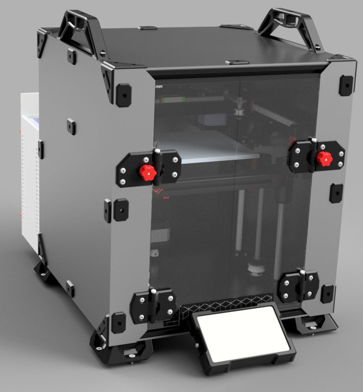
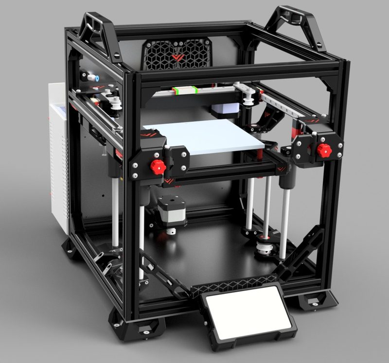
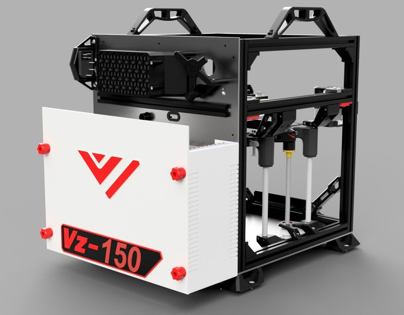
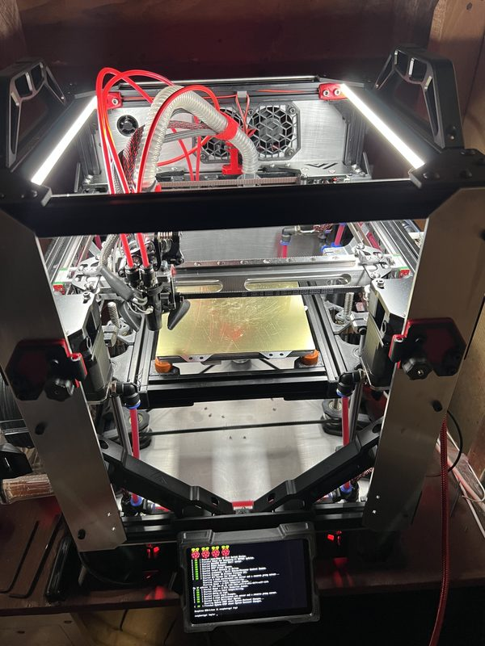
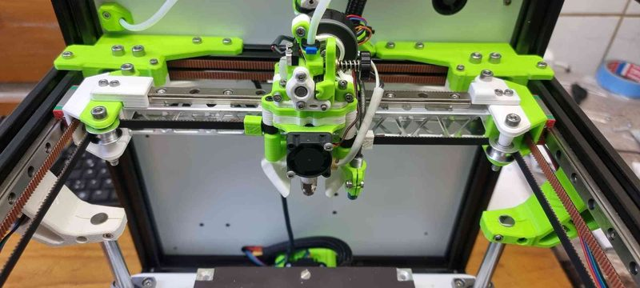
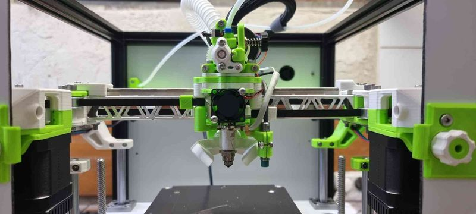
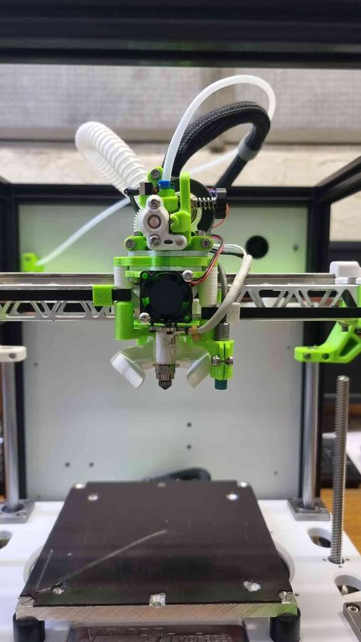
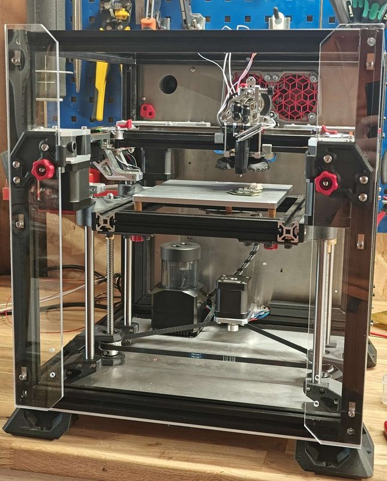

# VzBot Vz150

[Catalog row](../../README.md#vzbot-vz150) · [Gallery](../../GALLERY.md)

| Field | Value |
| --- | --- |
| Section | CoreXY · Small (≤180 mm representative X/Y size) |
| Project page | [https://github.com/VzBoT3D/VzBoT-Vz150](https://github.com/VzBoT3D/VzBoT-Vz150) |
| Author | VzBot family |
| About | Miniature VzBot; its optional AWD setup is described as experimental. |
| Build volume (X×Y×Z) | 150×150×125 |
| Exterior (W×D×H) | — |
| Latest version | V1.1 [2023-05](https://github.com/VzBoT3D/VzBoT-Vz150/commit/060e8cab89e4524243e828d4c5bea0fbefdd10b6) |
| Stars Likes Views |  |
| Links | [CAD](https://github.com/VzBoT3D/VzBoT-Vz150/tree/main/CAD) [BOM](https://github.com/VzBoT3D/VzBoT-Vz150/tree/main/BOM) |
| Groups | [Facebook](https://www.facebook.com/groups/vzbot/) EN 10.1K [Discord](https://discord.gg/KWZWvCMxCq) EN 9.3K [Reddit](https://www.reddit.com/r/vzbot/) EN 463 |
| License | [CC BY-NC 4.0](https://github.com/VzBoT3D/VzBoT-Vz150/blob/main/Readme.md) |

## Pictures (8)

<table>
<tr><td align="center" width="33%"> Photo: <a href="https://github.com/pbsuper">pbsuper</a></td><td align="center" width="33%"> Photo: <a href="https://github.com/pbsuper">pbsuper</a></td><td align="center" width="33%"> Photo: <a href="https://github.com/pbsuper">pbsuper</a></td></tr>
<tr><td align="center" width="33%"> Photo: <a href="https://github.com/pbsuper">pbsuper</a></td><td align="center" width="33%"></td><td align="center" width="33%"></td></tr>
<tr><td align="center" width="33%"></td><td align="center" width="33%"> Version: Vz150 Photo: <a href="https://github.com/pbsuper">pbsuper</a></td></tr>
</table>

## Other homes of the files

- Wayback Machine: [latest snapshot](https://web.archive.org/web/20240527132656/https://github.com/VzBoT3D/VzBoT-Vz150), 2024-05-27.
