# VzBot Vz330 / Vz235

[Catalog row](../../README.md#vzbot) · [Gallery](../../GALLERY.md)

| Field | Value |
| --- | --- |
| Section | CoreXY · Medium (181–299 mm representative X/Y size) |
| Project page | [https://github.com/VzBoT3D/VzBoT-Vz330](https://github.com/VzBoT3D/VzBoT-Vz330) |
| Author | VzBot family |
| About | High-speed CoreXY on a 2020 frame with MGN12 rails on Y, MGN9 on X, and a 2WD or AWD belt drive; one Z motor turns two belt-synced lead screws. The row covers the Vz330 and the smaller [Vz235](https://github.com/VzBoT3D/VzBoT-Vz235), which drops the top hat and offers a four-motor AWD setup. |
| Build volume (X×Y×Z) | Vz330: 330×330×400 Vz235: 235×235×225 |
| Exterior (W×D×H) | Vz330: 530×500×570 Vz235: — |
| Latest version | Vz235 V2.4 [2023-09](https://github.com/VzBoT3D/VzBoT-Vz235/commit/064705fd7de60a7ddd4127b69d9f973fae7efe71) |
| Stars Likes Views |  [⏯️⁠184K](https://www.youtube.com/watch?v=hcMxEkVvIdE) [❤️⁠3.5K](https://www.youtube.com/watch?v=hcMxEkVvIdE) |
| Links | [CAD](https://github.com/VzBoT3D/VzBoT-Vz330/tree/HEAD/CAD) Vz330 [Manual](https://github.com/VzBoT3D/VzBoT-Vz330/tree/HEAD/Build%20guide-manual) Vz330 [CAD](https://github.com/VzBoT3D/VzBoT-Vz235/tree/main/CAD) Vz235 [BOM](https://github.com/VzBoT3D/VzBoT-Vz235/tree/main/BOM) Vz235 [Manual](https://github.com/VzBoT3D/VzBoT-Vz235/blob/main/VZ235%20Manual_V1.pdf) Vz235 |
| Groups | [Facebook](https://www.facebook.com/groups/vzbot/) EN 10.1K [Discord](https://discord.gg/KWZWvCMxCq) EN 9.3K [Reddit](https://www.reddit.com/r/vzbot/) EN 463 |
| License | [CC BY-NC 4.0 (GitHub), CC BY-NC-SA 4.0 (docs.vzbot.org)](https://github.com/VzBoT3D/VzBoT-Vz330/blob/master/README.md) |

## Pictures (20)

<table>
<tr><td align="center" width="33%"> Version: Vz330 Photo: <a href="https://github.com/VzBoT3D">VzBoT</a></td><td align="center" width="33%"><a href="1-vzbot.jpg">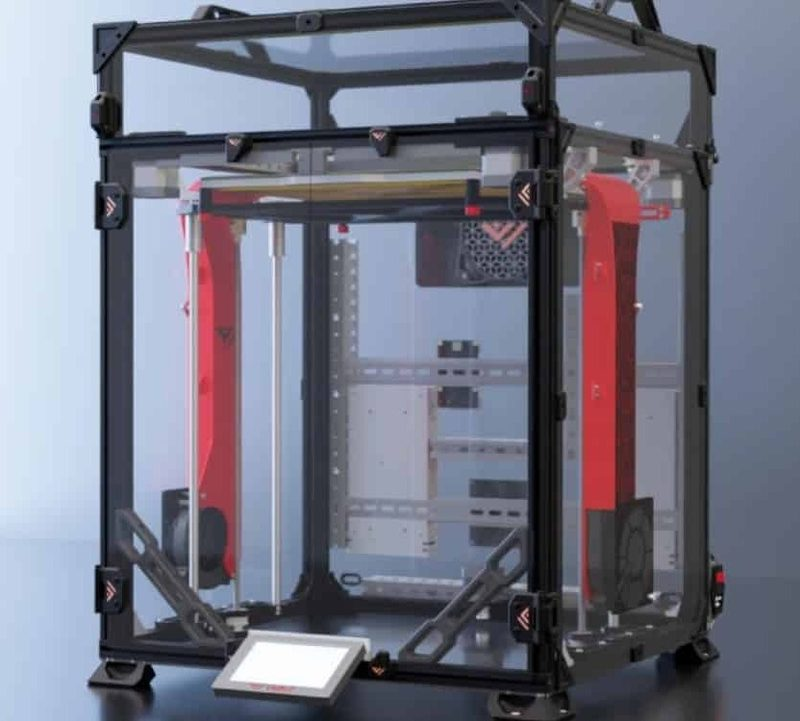</a> Version: Vz330 Photo: <a href="https://github.com/VzBoT3D">VzBoT</a></td><td align="center" width="33%"><a href="2-vzbot.jpg">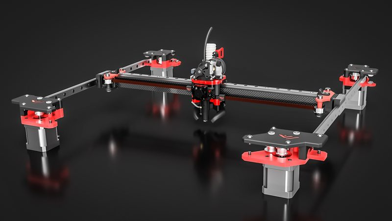</a> Version: Vz330 Photo: <a href="https://github.com/simonvez">VzBoT</a></td></tr>
<tr><td align="center" width="33%"><a href="3-vzbot.jpg">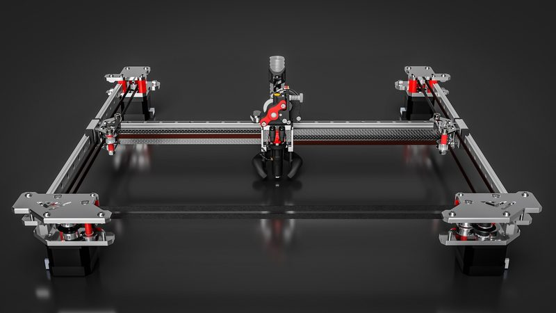</a> Version: Vz330 Photo: <a href="https://github.com/VzBoT3D">VzBoT</a></td><td align="center" width="33%"><a href="4-vzbot.jpg">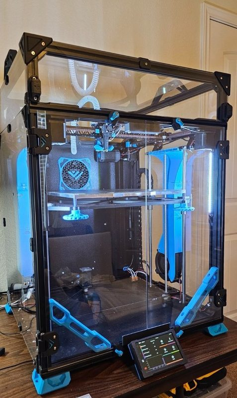</a> Version: Vz330 Photo: <a href="https://www.teamfdm.com/profile/3365-penatr8tor/">Penatr8tor</a></td><td align="center" width="33%"><a href="5-vzbot.jpg">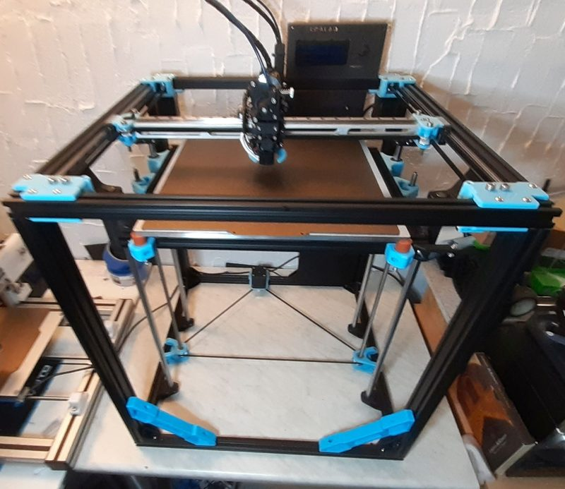</a> Version: Vz330 Photo: <a href="https://forum.drucktipps3d.de/user/16625-hubacca/">Hubacca</a></td></tr>
<tr><td align="center" width="33%"> Version: Vz235 Photo: <a href="https://github.com/Guillaume452">Guillaume van Schijndel (Guillaume452)</a></td><td align="center" width="33%"> Version: Vz235 Photo: <a href="https://github.com/Guillaume452">Guillaume van Schijndel (Guillaume452)</a></td><td align="center" width="33%"><a href="8-vzbot.jpg">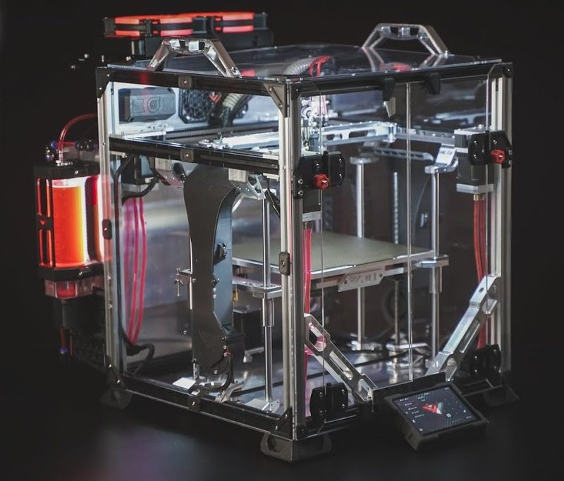</a> Version: Vz235 Photo: <a href="https://www.youtube.com/@Vez3D">Vez3D</a></td></tr>
<tr><td align="center" width="33%"><a href="9-vzbot.jpg">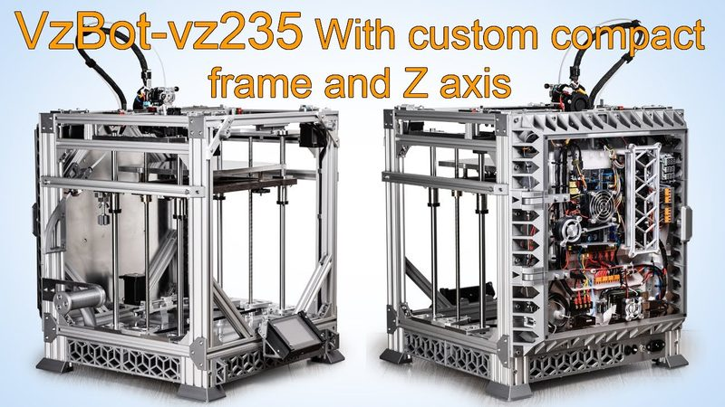</a> Version: Vz235 Photo: <a href="https://www.youtube.com/@balconyworkshop4185">Balcony workshop</a></td><td align="center" width="33%"><a href="10-vzbot.jpg">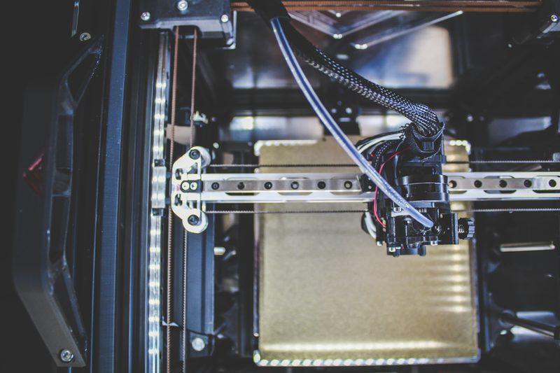</a> Version: Vz235 Photo: <a href="https://github.com/Guillaume452">Guillaume van Schijndel (Guillaume452)</a></td><td align="center" width="33%"> Version: Vz235 Photo: <a href="https://github.com/VzBoT3D">VzBoT</a></td></tr>
<tr><td align="center" width="33%"><a href="12-vzbot.jpg">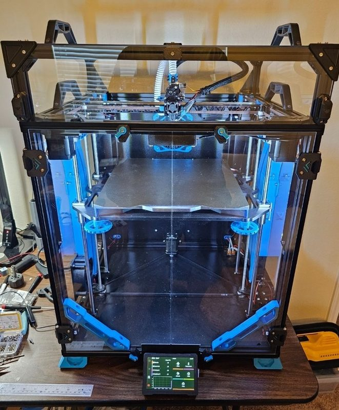</a> Version: Vz330 (AWD) Photo: <a href="https://www.teamfdm.com/profile/3365-penatr8tor/">Penatr8tor</a></td><td align="center" width="33%"><a href="13-vzbot.jpg">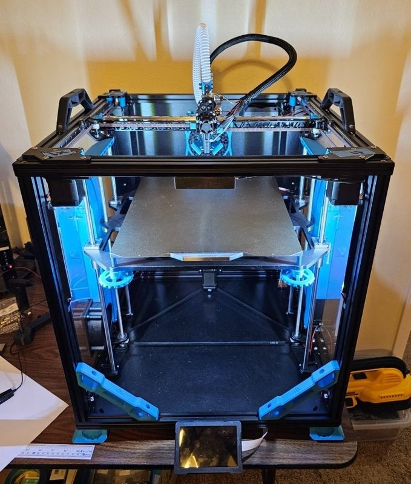</a> Version: Vz330 (AWD) Photo: <a href="https://www.teamfdm.com/profile/3365-penatr8tor/">Penatr8tor</a></td><td align="center" width="33%"><a href="14-vzbot.jpg">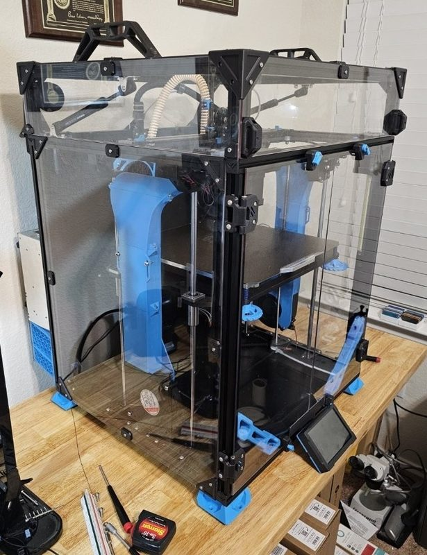</a> Version: Vz330 (AWD) Photo: <a href="https://www.teamfdm.com/profile/3365-penatr8tor/">Penatr8tor</a></td></tr>
<tr><td align="center" width="33%"><a href="15-vzbot.jpg">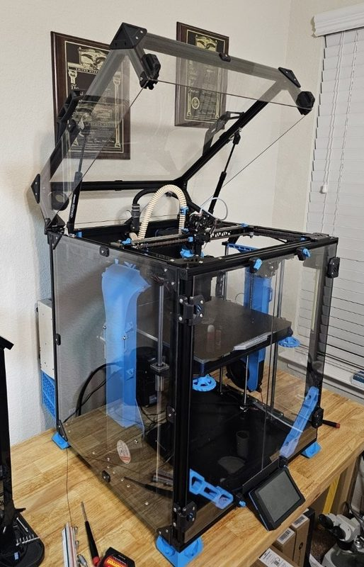</a> Version: Vz330 (AWD) Photo: <a href="https://www.teamfdm.com/profile/3365-penatr8tor/">Penatr8tor</a></td><td align="center" width="33%"><a href="16-vzbot.jpg">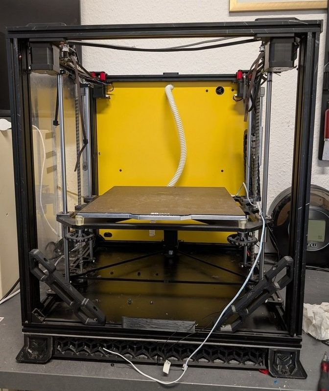</a> Version: Vz330 Photo: <a href="https://www.teamfdm.com/profile/11451-titusaduxass/">TitusADuxass</a></td><td align="center" width="33%"><a href="17-vzbot.jpg">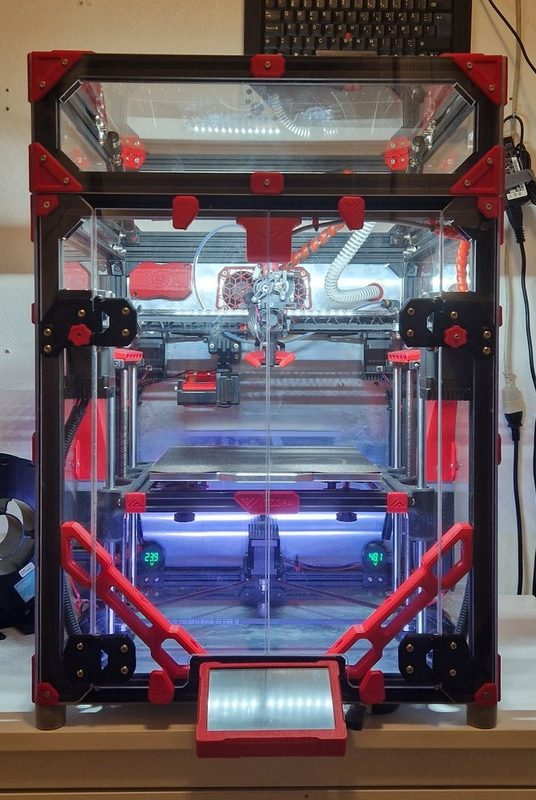</a> Version: Vz235 Photo: <a href="https://www.printables.com/@andersevenrud">Anders Evenrud</a></td></tr>
<tr><td align="center" width="33%"><a href="18-vzbot.jpg">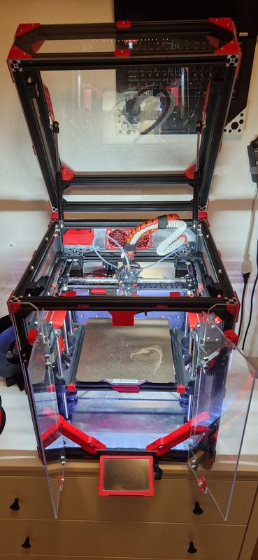</a> Version: Vz235 Photo: <a href="https://www.printables.com/@andersevenrud">Anders Evenrud</a></td><td align="center" width="33%"><a href="19-vzbot.jpg">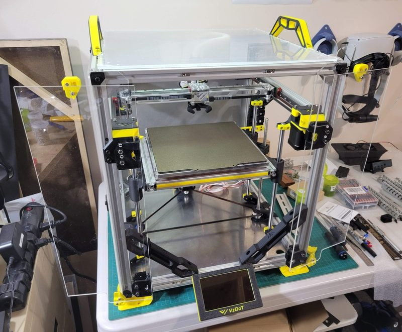</a> Version: Vz235 Photo: <a href="https://github.com/Rodamyot">Rodrigue Amyot (Rodamyot)</a></td></tr>
</table>

## Other homes of the files

- [VzBot docs, Vz330](https://docs.vzbot.org/vz330_printed): online build manual for the printed version, CC BY-NC-SA 4.0 (site footer).
- [VzBot docs, Vz330 Mellow kit](https://docs.vzbot.org/vz330_mellow): online build manual for the Mellow CNC kit, CC BY-NC-SA 4.0 (site footer).
- [Autodesk Fusion](https://a360.co/3FtdnGd): Fusion model of the printed Vz330, linked from the repo README, no license shown.
- [Autodesk Fusion](https://a360.co/4iu8HhW): Fusion model of the full Vz330 CNC AWD kit, linked from the repo README, no license shown.
- [VzBot docs, Vz235](https://docs.vzbot.org/vz235_printed): online build manual for the printed version. CC BY-NC-SA 4.0 (site footer).
- [VzBot docs, Vz235](https://docs.vzbot.org/vz235_mellow): online build manual for the Mellow CNC kit. CC BY-NC-SA 4.0 (site footer).
- [VzBot docs, Vz235](https://docs.vzbot.org/vz235-awd/): AWD video tutorial page. CC BY-NC-SA 4.0 (site footer).
- [Autodesk Fusion](https://a360.co/4ig13Yv): web model of the printed Vz235, linked from the README. No license shown.
- [Autodesk Fusion](https://a360.co/3DxAVt8): web model of the full Vz235 Mellow CNC kit, linked from the README. No license shown.
- Wayback Machine, latest snapshot of each repository:
  - [VzBoT-Vz330](https://web.archive.org/web/20260216085502/https://github.com/VzBoT3D/VzBoT-Vz330) 2026-02-16
  - [VzBoT-Vz235](https://web.archive.org/web/20251129081006/https://github.com/VzBoT3D/VzBoT-Vz235) 2025-11-29

## Popular mods

- [VzBoT UserMods](https://github.com/VzBoT3D/VzBoT-UserMods) by VzBoT3D community: official collection of community mods: printhead variants, extruder mounts, tophat, screens, endstops and more. License not stated.
- [VZ-Bot Frame Brace with 2020 profile](https://www.printables.com/model/413674-vz-bot-frame-brace-with-2020-profile) by Aldoale: frame reinforcement from a 10 cm 2020 profile and two printed ABS parts. CC BY-NC-SA 4.0.
- [CPAP Muffler for Vz-Bot 330](https://www.printables.com/model/561659-cpap-muffler-for-vz-bot-330) by Aldoale: muffler for the CPAP blower, adapted from the Vz235 original. CC BY-NC-SA 4.0.
- [VzBot fan ducts for Klicky and Quickdraw probes](https://www.printables.com/model/332141-contribution-to-the-various-vzbot-fanduct-systems-) by Nanodesigner: fan duct variants for the VzBot printhead that fit Klicky and Annex Quickdraw probes. CC BY-NC 4.0.
- [EBB36 VZBOT VZ235 VZ330 MOUNT - NEW BEACON DUCT](https://www.printables.com/model/766767-ebb36-vzbot-vz235-vz330-mount-new-beacon-duct) by Marcin Miszewski: BTT EBB36 toolboard mount and a Beacon probe duct for the printhead. CC BY-NC 4.0.
- [Magneto Filament Cutter](https://github.com/Treintjes/Magneto_Filament_Cutter) by Treintjes: filament cutter that replaces the VzBot printhead adapter plate and adds 2 mm to hotend length. CC BY-NC 4.0.
- [Custom VZBot printhead](https://www.printables.com/model/251402-custom-vzbot-printhead) by Ujang Karnadi: printed printhead remixed from EVA with the features of the aluminium VzBot printhead. CC BY 4.0.
- [VZBot 235 Top Hat 125mm Tall](https://www.printables.com/model/840109-vzbot-235-top-hat-125mm-tall) by RedGT500: 125 mm top hat that gives clearance for the CPAP and harness. CC BY-SA 4.0.
- [EBB36 CanBus Board Mount for VZBot Printhead CNC V2](https://www.printables.com/model/418831-ebb36-canbus-board-mount-for-vzbot-printhead-cnc-v) by Krzysztof Nowak: BTT EBB36 CAN toolboard mount for the CNC printhead V2. GPL-2.0.
- [Vz-Bot Printhead Rapido Heatsink Duct 3010 Fan](https://www.printables.com/model/496217-vz-bot-printhead-rapido-heatsink-duct-3010-fan) by Aldoale: heatsink duct with a 3010 fan for a Rapido hotend on the printhead. CC BY-NC-SA 4.0.
