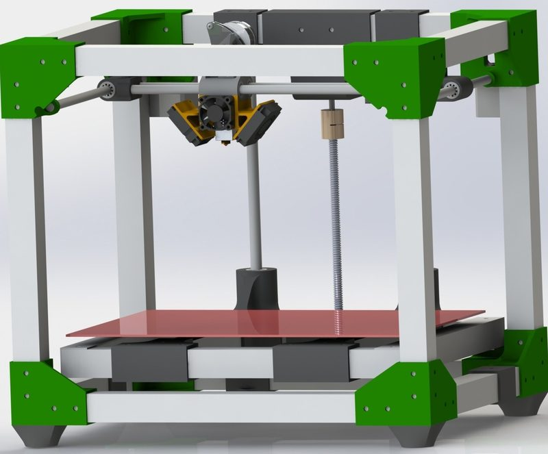
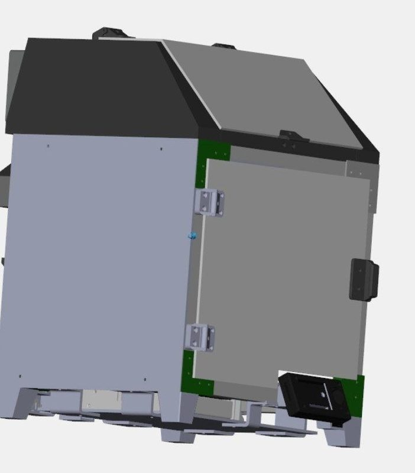
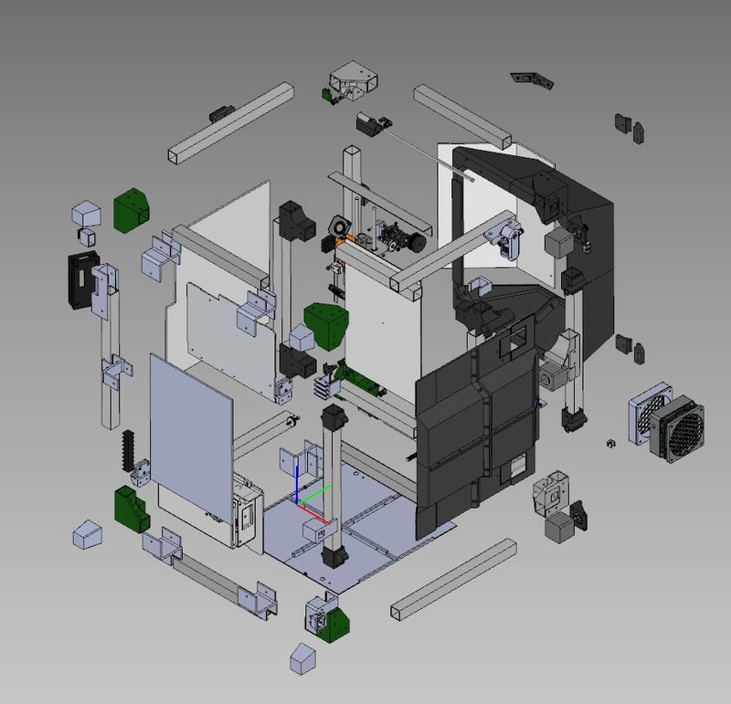
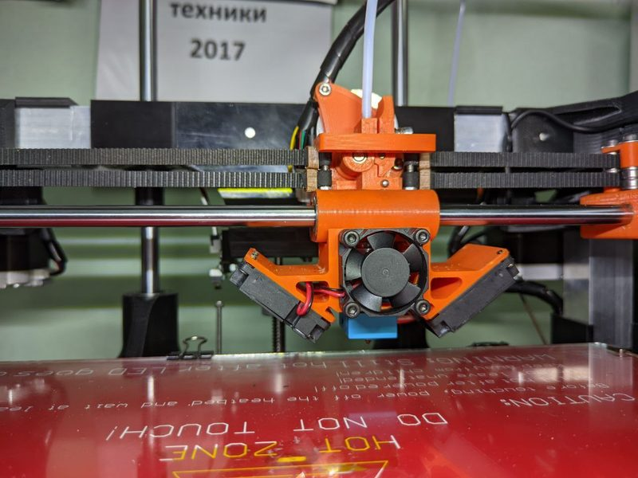

# W-Mini-CoreXY

[Catalog row](../../README.md#w-mini-corexy) · [Gallery](../../GALLERY.md)

| Field | Value |
| --- | --- |
| Section | CoreXY · Medium (181–299 mm representative X/Y size) |
| Project page | [https://github.com/whoim2/w-mini-corexy](https://github.com/whoim2/w-mini-corexy) |
| Author | whoim |
| About | Low-cost CoreXY with a frame of 25 mm square aluminium tube, printed corners and 8 mm shafts with printed bearings. X and Y home without end stops. |
| Build volume (X×Y×Z) | 238×188×150 |
| Exterior (W×D×H) | — |
| Latest version | STEP [2023-01](https://github.com/whoim2/w-mini-corexy/commit/36fcfebf692ae2b57cefb57a4e2d642bf240f3d8) |
| Stars Likes Views |  [⏯️⁠2.5K](https://www.youtube.com/watch?v=Zjof3f4mJVk) [❤️⁠53](https://www.youtube.com/watch?v=Zjof3f4mJVk) |
| Links | [CAD](https://github.com/whoim2/w-mini-corexy/blob/main/Assembly.SLDASM) [STL](https://github.com/whoim2/w-mini-corexy/tree/main/stl) [Config](https://github.com/whoim2/w-mini-corexy/tree/main/klipper) [Files](https://disk.yandex.ru/d/OpFREoRlxXPGTw) [STEP](https://github.com/whoim2/w-mini-corexy/blob/main/Ahiko/Assembly1.STEP.zip) Ahiko [Video](https://www.youtube.com/watch?v=Zjof3f4mJVk) |
| Groups | [Telegram](https://t.me/savelylive) RU 227 |
| License | [GPL-2.0 (GitHub)](https://github.com/whoim2/w-mini-corexy/blob/main/LICENSE) |

## Pictures (4)

<table>
<tr><td align="center" width="33%"> Photo: <a href="https://github.com/whoim2">whoim</a></td><td align="center" width="33%"> Version: Ahiko mod (enclosed) Photo: <a href="https://github.com/whoim2">whoim</a></td><td align="center" width="33%"> Version: Ahiko mod (enclosed) Photo: <a href="https://github.com/whoim2">whoim</a></td></tr>
<tr><td align="center" width="33%"> Version: Ahiko build Photo: <a href="https://github.com/whoim2">whoim</a></td></tr>
</table>
