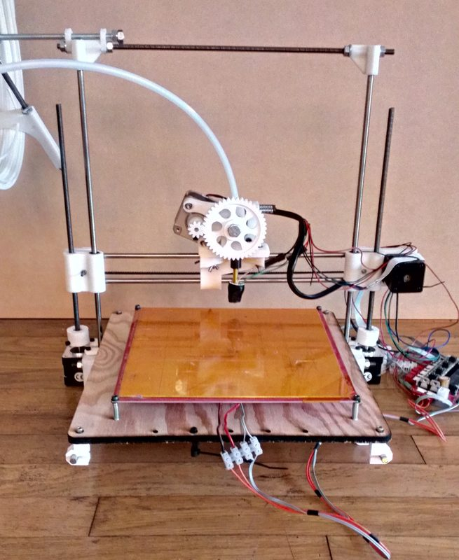
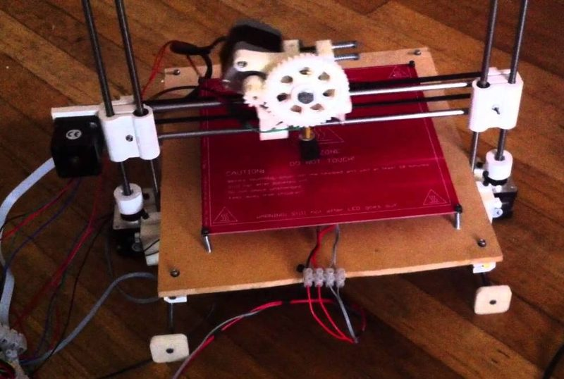
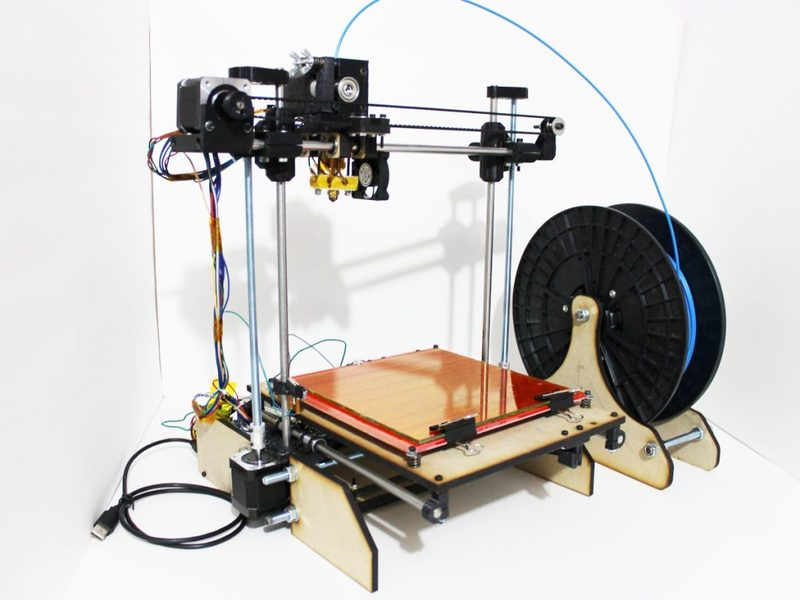
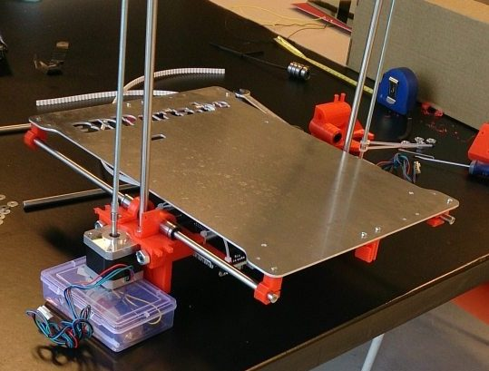
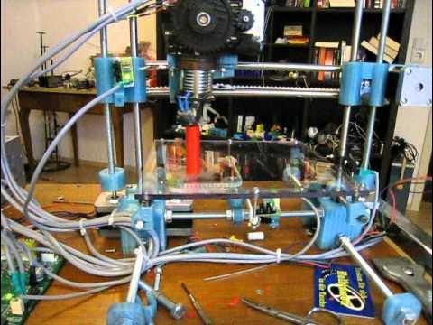

# Wallace

[Catalog row](../../README.md#wallace) · [Gallery](../../GALLERY.md)

| Field | Value |
| --- | --- |
| Section | Historical designs |
| Project page | [https://github.com/whosawhatsis/RepRap-Wallace](https://github.com/whosawhatsis/RepRap-Wallace) |
| Author | Whosawhatsis |
| About | Parametric, minimalist early Cartesian design. Later simple RepRaps copied its minimal frame. |
| Build volume (X×Y×Z) | 200×200×140 |
| Exterior (W×D×H) | — |
| Latest version | CAD [2012-02](https://github.com/whosawhatsis/RepRap-Wallace/commit/22788bdad7114b5d66fb84c0653973bc2ed760f2) |
| Stars Likes Views |  [💙⁠436](https://www.thingiverse.com/thing:14208) [⏯️⁠32.5K](https://www.youtube.com/watch?v=0QrEmGlZT0w) [❤️⁠22](https://www.youtube.com/watch?v=0QrEmGlZT0w) |
| Links | [Manual](https://reprap.org/wiki/Wallace) |
| Groups | — |
| License | [GPL-2.0 (Thingiverse)](https://www.thingiverse.com/thing:14208) |

## Pictures (5)

<table>
<tr><td align="center" width="33%"> Photo: <a href="https://reprap.org/wiki/User:Whosawhatsis">Whosawhatsis</a></td><td align="center" width="33%"> Photo: <a href="https://www.youtube.com/@Whosawhatsis">Whosawhatsis</a></td><td align="center" width="33%"> Photo: <a href="https://www.reddit.com/user/conflicter">u/conflicter</a></td></tr>
<tr><td align="center" width="33%"> Photo: <a href="https://www.dailybits.be/item/author/herman/">Herman Maes</a></td><td align="center" width="33%"> Photo: <a href="https://www.youtube.com/@domonoky">domonoky</a></td></tr>
</table>

## Other homes of the files

- [Thingiverse](https://www.thingiverse.com/thing:14208): 19 files. GPL-2.0.
- Wayback Machine: [latest snapshot](https://web.archive.org/web/20250403075541/https://github.com/whosawhatsis/RepRap-Wallace), 2025-04-03.
