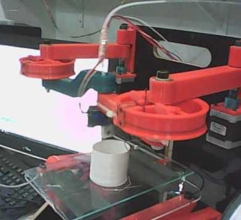
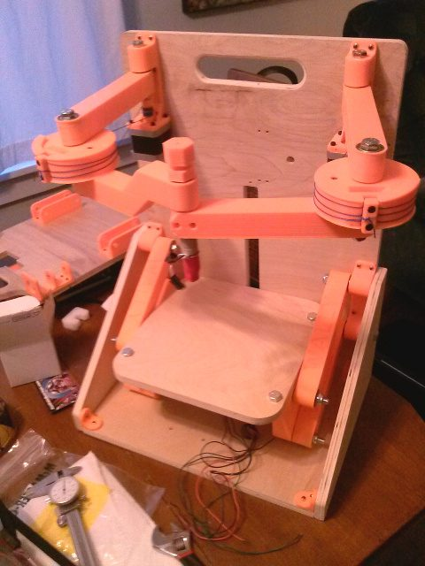
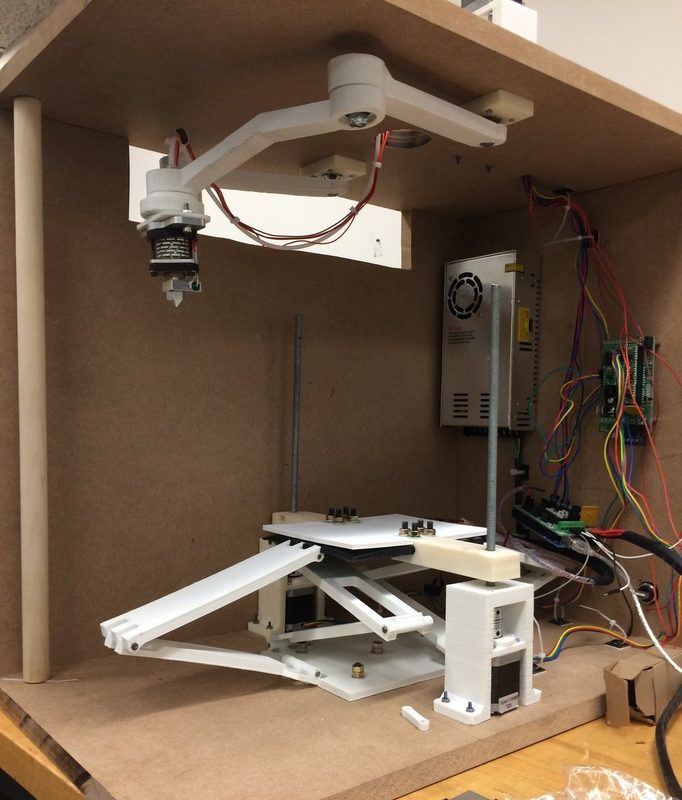

# Wally

[Catalog row](../../README.md#wally) · [Gallery](../../GALLERY.md)

| Field | Value |
| --- | --- |
| Section | Historical designs |
| Project page | [https://reprap.org/wiki/Wally](https://reprap.org/wiki/Wally) |
| Author | RepRap |
| About | Compact printed SCARA, and one of the early SCARA printers. |
| Build volume (X×Y×Z) | 150×150×? Ø200×? |
| Exterior (W×D×H) | — |
| Latest version | CAD [2014-03](https://github.com/NicholasSeward/ConceptFORGE/commit/ac16f74621393b2546382053cf1fa064c8461e51) |
| Stars Likes Views | [⏯️⁠31.5K](https://www.youtube.com/watch?v=iVg7WrgHJik) [❤️⁠171](https://www.youtube.com/watch?v=iVg7WrgHJik) |
| Links | — |
| Groups | [Forum](https://reprap.org/forum/list.php?185) EN |

## Pictures (4)

<table>
<tr><td align="center" width="33%"></td><td align="center" width="33%"></td><td align="center" width="33%"></td></tr>
<tr><td align="center" width="33%"></td></tr>
</table>
