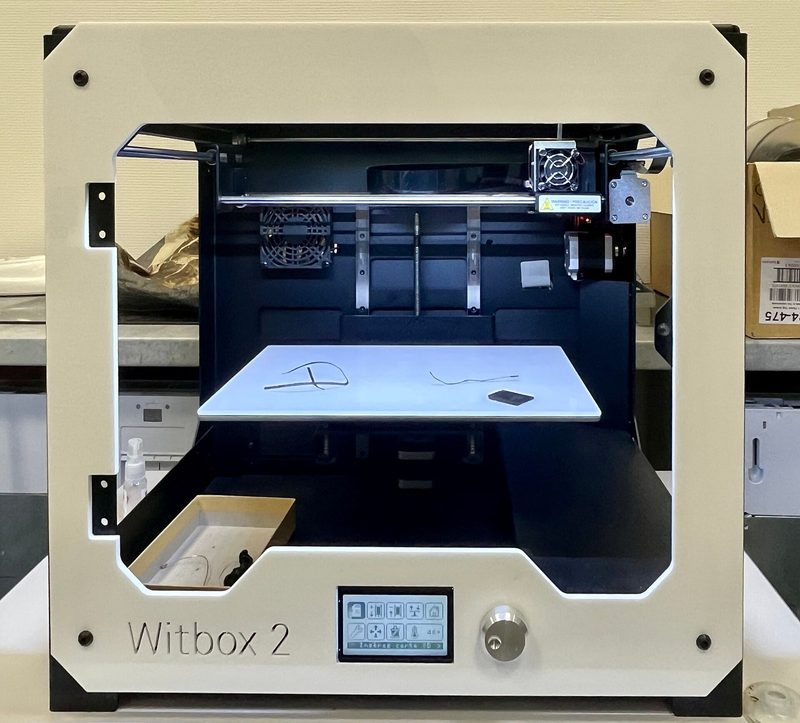
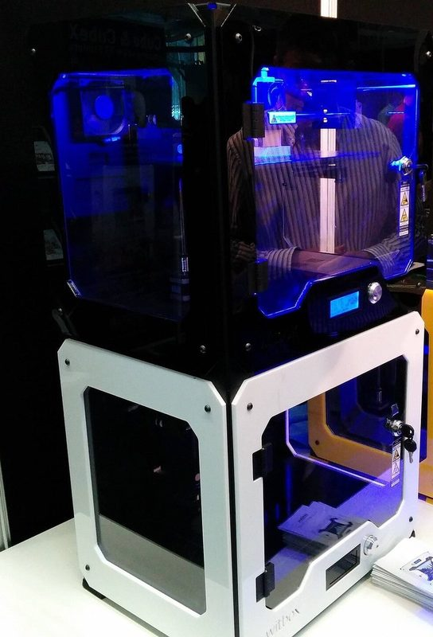
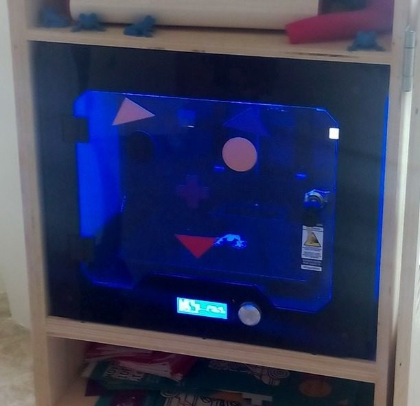

# bq Witbox / Witbox 2

[Catalog row](../../README.md#witbox) · [Gallery](../../GALLERY.md)

| Field | Value |
| --- | --- |
| Section | Legacy designs |
| Project page | [https://github.com/bq/witbox-2](https://github.com/bq/witbox-2) |
| Author | bq |
| About | Enclosed Spanish desktop printer with a moving XY head and a Z bed, sold fully assembled and released with CC BY-SA sources. Versions: the first Witbox with Inventor, STEP, and FreeCAD files, and the 2015 Witbox 2 with a STEP model and electronics sources. No update since 2016-04. |
| Build volume (X×Y×Z) | 2: 297×210×200 |
| Exterior (W×D×H) | — |
| Latest version | 2 STEP [2015-11](https://github.com/bq/witbox-2/commit/f4445575270c3df5d6a8b3285e9c9b3b22cb3ff1) |
| Stars Likes Views |  [⏯️⁠40.4K](https://www.youtube.com/watch?v=_dJlHRiK4JY) [❤️⁠84](https://www.youtube.com/watch?v=_dJlHRiK4JY) |
| Links | [STEP](https://github.com/bq/witbox-2/blob/master/Mechanical%20Design/Mechanics_Witbox2.zip) [BOM](https://github.com/bq/witbox-2/blob/master/Witbox2-LOM.ods) [Files](https://github.com/bq/witbox-2/tree/master/Electronic%20Design) [FW](https://github.com/bq/Marlin) [STEP](https://github.com/bq/witbox/blob/master/autodesk-inventor/step/Witbox-assembly-original_v04.stp.zip) old 1 [CAD](https://github.com/bq/witbox/tree/master/freecad) old 1 [BOM](https://github.com/bq/witbox/blob/master/Witbox-BOM.ods) old 1 |
| Groups | — |
| License | [CC BY-SA 4.0](https://github.com/bq/witbox/blob/master/LICENSE) |

## Pictures (4)

<table>
<tr><td align="center" width="33%"> Version: Witbox 2 Photo: <a href="https://github.com/bq">bq</a></td><td align="center" width="33%"> Version: Witbox 2 Photo: <a href="https://commons.wikimedia.org/wiki/User:Beno%C3%AEt_Prieur">Benoît Prieur</a></td><td align="center" width="33%"> Version: Witbox (first version, 2014) Photo: <a href="https://www.flickr.com/people/creative_tools/">Creative Tools</a></td></tr>
<tr><td align="center" width="33%"> Version: Witbox (first version) Photo: <a href="https://commons.wikimedia.org/wiki/User:Nemigo">Nemigo</a></td></tr>
</table>
