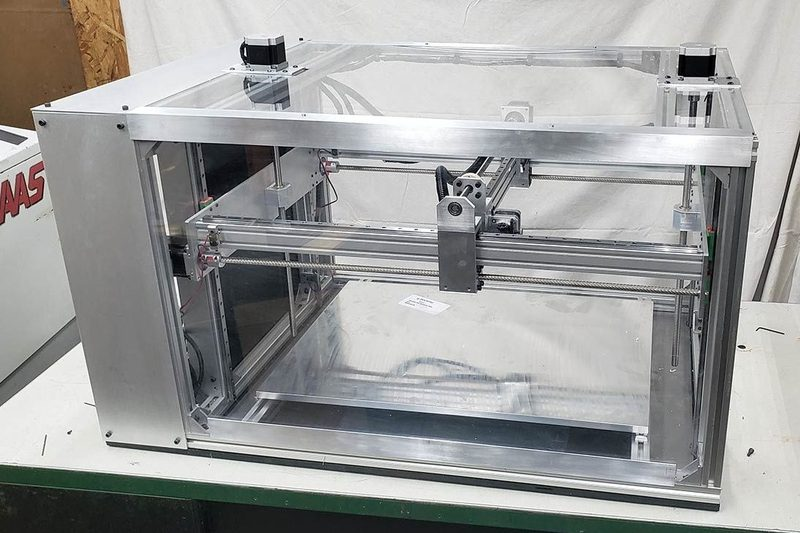
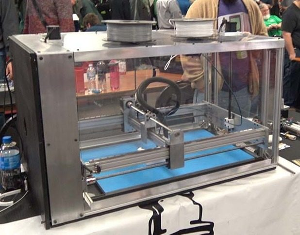
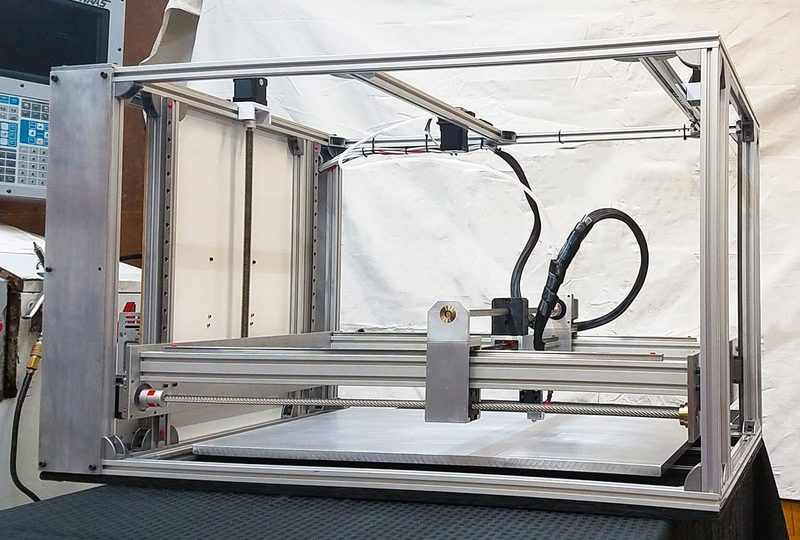
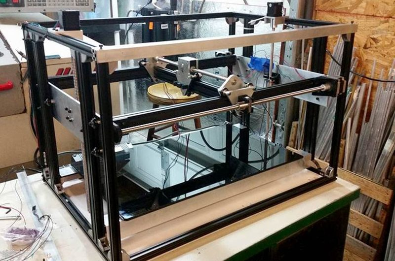
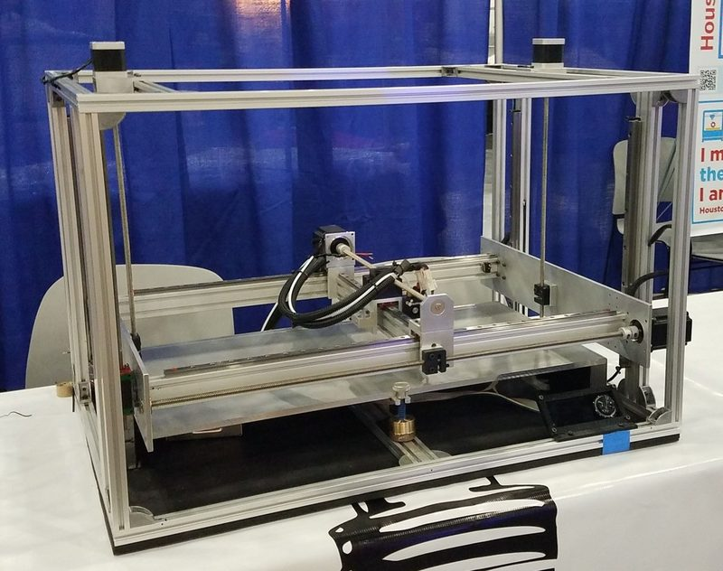
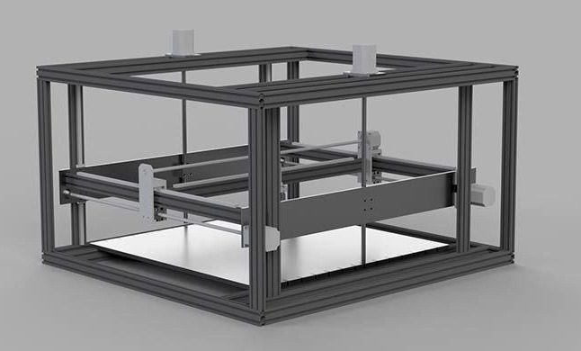

# WorkHorse

[Catalog row](../../README.md#workhorse) · [Gallery](../../GALLERY.md)

| Field | Value |
| --- | --- |
| Section | Legacy designs |
| Project page | [https://github.com/shanehooper/WorkHorse3DPrinter](https://github.com/shanehooper/WorkHorse3DPrinter) |
| Author | Shane Hooper / 3D Distributed |
| About | Large fixed-bed gantry Cartesian that drives X, Y, and Z with lead screws instead of belts. Versions are the Pilot Printer (2017), WorkHorse V1 and V2, and the 600 mm WorkHorse XL. No update since 2022-05. |
| Build volume (X×Y×Z) | 650×350×350 XL: 600×600×600 |
| Exterior (W×D×H) | — |
| Latest version | Log [2022-05](https://hackaday.io/project/177793/log/206423-upgraded-z-axis-stepper-motor-mounts) |
| Stars Likes Views |  [💙⁠179](https://www.thingiverse.com/thing:2764064) [⏯️⁠34.3K](https://www.youtube.com/watch?v=Wc8GtOipFH0) [❤️⁠251](https://www.youtube.com/watch?v=Wc8GtOipFH0) |
| Links | [STEP](https://cdn.hackaday.io/files/1777937606695712/Workhorse%20Printer%20v150.step) [CAD](https://github.com/shanehooper/WorkHorse3DPrinter/blob/main/Workhorse%20Printer%20v150.zip) [BOM](https://drive.google.com/file/d/1DFuWNZOoG8Cqf1KFIUr0Qn61HkigWl7B/view) [Manual](https://3ddistributed.com/3d-printer-assembly-instructions/) [Config](https://drive.google.com/drive/folders/17vdb16JmCTgNdajL9iVTMRIMCVJ3nyBD) [Files](https://www.thingiverse.com/thing:2638636) old Pilot |
| Groups | [Facebook](https://www.facebook.com/groups/advanced3dprinter) EN |
| License | [CC0-1.0 (GitHub), CC BY-SA 4.0 (Thingiverse), CC BY-NC-SA 4.0 (MyMiniFactory, Pilot Printer on Thingiverse)](https://github.com/shanehooper/WorkHorse3DPrinter/blob/main/LICENSE) |

## Pictures (7)

<table>
<tr><td align="center" width="33%"> Version: V2 Photo: <a href="https://3ddistributed.com/author/shane77304/">Shane Hooper</a></td><td align="center" width="33%"> Version: V2 Photo: <a href="https://www.thingiverse.com/shanehooper">Shane Hooper</a></td><td align="center" width="33%"> Version: MRRF 2019 show unit Photo: <a href="https://3ddistributed.com/">3D Distributed</a></td></tr>
<tr><td align="center" width="33%"> Version: V1 Photo: <a href="https://hackaday.io/hacker/159019-shane-hooper">Shane Hooper</a></td><td align="center" width="33%"> Version: V0 prototype Photo: <a href="https://www.thingiverse.com/shanehooper">Shane Hooper</a></td><td align="center" width="33%"> Version: Pilot Printer (earlier design) Photo: <a href="https://www.thingiverse.com/shanehooper">Shane Hooper</a></td></tr>
<tr><td align="center" width="33%"> Version: WorkHorse XL Photo: <a href="https://www.thingiverse.com/shanehooper">Shane Hooper</a></td></tr>
</table>

## Mods and variants

- [Pilot Printer](https://www.thingiverse.com/thing:2638636): the earlier design that became the WorkHorse (2017).
- WorkHorse V0: ball-screw gantry prototype, shown in the [Thingiverse description](https://www.thingiverse.com/thing:2764064).
- WorkHorse XL: 600×600×600 version, described on the [Thingiverse page](https://www.thingiverse.com/thing:2764064) with [a video](https://www.youtube.com/watch?v=VuWlZZ0xUJ8).
- [WorkHorse V2 frame](https://3ddistributed.com/3d-printers/workhorse-printer/): 3030 extrusion frame with wider side panels.
